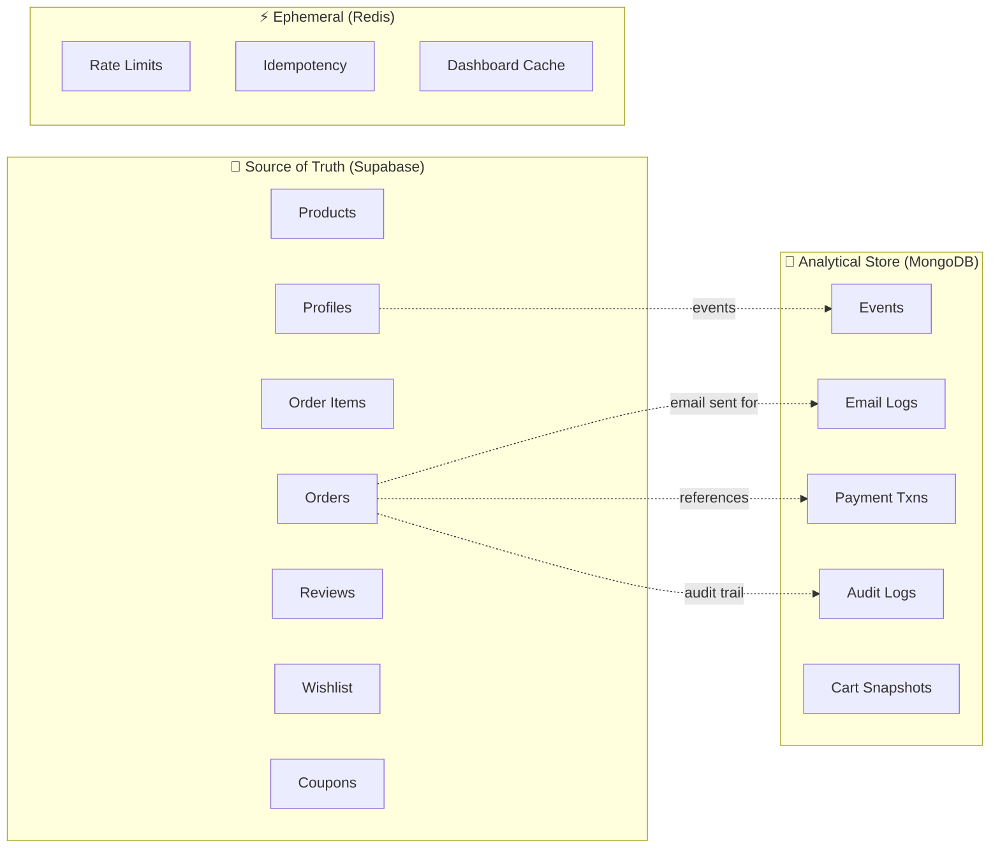

# Architecture Deep Dive

> **Audience:** Engineers who want to understand *why* VESTIOR is built this way, not just *what* it does.
>
> **Prerequisites:** Basic familiarity with Next.js, PostgreSQL, Redis, and serverless concepts.

---

## Table of Contents

- [Design Philosophy](#design-philosophy)
- [Dual-Database Rationale](#dual-database-rationale)
- [Data Ownership Boundaries](#data-ownership-boundaries)
- [Request Lifecycle Walkthroughs](#request-lifecycle-walkthroughs)
- [Atomic Operation Patterns](#atomic-operation-patterns)
- [Failure Modes & Graceful Degradation](#failure-modes--graceful-degradation)
- [Scalability Path](#scalability-path)
- [Trade-off Decisions](#trade-off-decisions)
- [What We Deliberately Avoided](#what-we-deliberately-avoided)
- [Further Reading](#further-reading)

---

## Design Philosophy

VESTIOR is built on **six core principles**. Every architectural decision traces back to one of them. If a change violates any of these, it doesn't ship.

### 1. Single Source of Truth

**Each piece of data lives in exactly one place.**

- **Supabase** is the source of truth for *transactional* data — products, orders, users, reviews, coupons, wishlists.
- **MongoDB** is the source of truth for *eventual, append-only* data — analytics events, audit logs, email delivery history, cart snapshots.
- **Redis** is the source of truth for *ephemeral* state — rate limit counters, idempotency locks, dashboard cache.

**Why it matters:** Ambiguity about "where is the truth" is the #1 cause of production bugs. If a number can be computed two ways, eventually it will disagree with itself.

**Example violation we avoided:** We do *not* store a product's average rating as a column on `products`. If we did, every review insert/delete would need a `products` UPDATE, and drift would be inevitable. Instead, the average is computed on-demand from `product_reviews` via an RPC. It's `O(rows)` but always correct.

---

### 2. Stateless Compute

**Every Vercel Function, every Server Action, every API route is stateless.**

- No in-memory session state.
- No process-level caches.
- No global variables that persist across invocations (except immutable singletons like the MongoDB client pool).

**Why it matters:** Serverless compute can spin up or tear down instances arbitrarily. Any state held in memory is lost on the next cold start. Anything that *looks* like it works locally will silently break in production.

**Example:** Authentication uses HTTP-only cookies (server-managed), not in-memory sessions. Cart state uses `localStorage` (client-managed), not a global store. Tracked events use `sendBeacon` batches (client-managed), not a persistent socket.

---

### 3. Queue-First Async

**Anything that takes more than 200ms and doesn't need to block the user request goes into a queue.**

Concretely:

| Operation | Approach |
|-----------|----------|
| Order placement | **Blocking** — user needs order ID |
| Stock deduction | **Blocking** — must be atomic |
| Coupon redemption | **Blocking** — must be atomic |
| Welcome email | **Queued** (QStash) |
| Order-placed email | **Queued** |
| Invoice PDF generation | **Queued** (future) |
| Analytics event ingestion | **Batched** client-side, then **queued** |
| Abandoned cart reminder | **Cron-triggered** |
| Daily analytics rollup | **Cron-triggered** |

**Why it matters:** Vercel Functions have **10s limits on Hobby, 60s on Pro**. SMTP connections regularly take 2-5s. Stripe webhook processing can take 3-8s. Blending these with user-facing requests causes flaky timeouts and lost work.

**Key insight:** The user should never wait for an email to be sent. They should wait for *confirmation that the email will be sent*.

---

### 4. Provider Abstraction

**External services sit behind interfaces.** Business logic never imports a specific provider directly.

Two abstractions exist today:

**Payments** — `src/lib/payments/types.ts` defines `PaymentProvider`:

```typescript
interface PaymentProvider {
  id: PaymentProviderId
  createPaymentIntent(params): Promise<PaymentIntent>
  retrievePayment(intentId): Promise<PaymentResult>
  capturePayment(intentId): Promise<PaymentResult>
  refundPayment(intentId, amount?): Promise<PaymentResult>
  verifyWebhook(payload, signature): Promise<WebhookEvent>
}
```

Providers:
- `cod.ts` — cash on delivery (no external API)
- `stripe.ts` — Stripe Payment Intents

Adding PayPal (or Razorpay, or Adyen) means writing **one new file** and registering it in `index.ts`. Nothing else changes.

**Email** — `src/lib/email/mailer.ts` wraps Gmail SMTP. Swapping to Resend/Postmark/SES means replacing one file.

**Why it matters:** Vendor lock-in is a real business risk. Stripe goes down? Switch to Adyen. Gmail rate limits? Switch to Resend. The interface makes this a *configuration change*, not a *rewrite*.

---

### 5. Defense in Depth

**Security is layered.** No single control is trusted to be sufficient.

```
Layer 1: Input validation    (Zod schemas)
Layer 2: Authentication     (Supabase Auth)
Layer 3: Authorization      (middleware + RLS + server checks)
Layer 4: Rate limiting      (Upstash Redis)
Layer 5: CSRF protection    (Server Actions built-in)
Layer 6: XSS prevention     (React escaping + CSP)
Layer 7: Secret isolation   (server-only imports)
Layer 8: Webhook signatures (Stripe + QStash)
Layer 9: Idempotency        (Redis SETNX)
Layer 10: Audit logging     (MongoDB)
```

**Key principle:** Assume any single layer *will* fail. Layer N+1 must catch what Layer N missed.

**Concrete example:** A user modifies `localStorage.cart` to set price = ₹1. Layer 1 (Zod) accepts it — we don't validate price client-side. Layer 3 (server check) fetches the authoritative price from DB and ignores the client value. Attacker loses.

---

### 6. Observable by Default

**Every critical path emits structured logs.** Errors go to Sentry (planned). Business metrics go to MongoDB.

- **Server errors:** `console.error` with structured objects (message + digest + stack + context)
- **Business events:** Tracked in MongoDB `events` collection with IP hash, device, referrer
- **Admin actions:** Every privileged mutation writes to `audit_logs`
- **Email delivery:** Every send logged with status + provider message ID
- **Payment lifecycle:** Every webhook event appended to `payment_transactions.webhook_events`

**Why it matters:** When something breaks in production, you need to answer:
1. What happened?
2. When?
3. To whom?
4. Why?

If those answers require re-running the code, you have an observability problem.

---

## Dual-Database Rationale

**"Why two databases? Isn't that over-engineering?"**

Legitimate question. The short answer: **Because the access patterns are fundamentally different, and forcing them into one database creates either performance debt or schema pollution.**

### Access Pattern Comparison

| Dimension | Supabase (PostgreSQL) | MongoDB Atlas |
|-----------|----------------------|---------------|
| **Write pattern** | Low-frequency, transactional | High-frequency, append-only |
| **Read pattern** | Row lookups by PK/FK | Aggregations over time windows |
| **Consistency** | ACID required | Eventual is fine |
| **Schema** | Strict (typed columns) | Flexible (varies by event type) |
| **Retention** | Forever (source of truth) | 90 days (events), forever (logs) |
| **Volume** | Thousands of rows | Millions of events |

### What lives where

**Supabase — Transactional Core**
- `products` — catalog
- `orders` — headers
- `order_items` — line items
- `profiles` — user metadata
- `product_reviews` — moderated reviews
- `wishlists` — user-to-product mapping
- `coupons` + `coupon_redemptions` — discount economy

**MongoDB Atlas — Analytical & Event Layer**
- `events` — user behavior (page views, product views, cart events)
- `email_logs` — delivery history with webhooks
- `payment_transactions` — Stripe audit trail
- `audit_logs` — admin action timeline
- `cart_snapshots` — abandoned cart recovery state
- `analytics_daily` — pre-aggregated rollups

### Why not Postgres for events?

1. **Write amplification.** 100 visitors × 10 events = 1,000 INSERTs/min. Postgres handles this, but each row needs indexes. With TTL not built-in, you need `pg_cron` + partition pruning.
2. **Schema evolution.** A new event type with different properties = `ALTER TABLE` or a `jsonb` column. With MongoDB, it's just another document.
3. **Aggregation cost.** "Top products viewed in the last 7 days" is a `$group` over millions of docs. MongoDB's aggregation pipeline is 2-3x faster for this shape than Postgres GROUP BY on a large table.
4. **Operational risk.** Analytics load spiking shouldn't affect checkout latency.

### Why not MongoDB for orders?

1. **No ACID across documents** (without transactions, which are slower than Postgres).
2. **No foreign keys.** Can't enforce `order_items.product_id → products.id`.
3. **No row-level security.** RLS is a Postgres superpower; MongoDB Atlas has Field-Level Encryption but not the same ergonomics.
4. **Supabase Auth is already there.** Profiles need to reference `auth.users`.

### The rule

> **If losing a row breaks money or trust → Supabase.**
> **If losing a row just makes a dashboard slightly wrong → MongoDB.**

This rule has never failed us.

---

## Data Ownership Boundaries



**Cross-boundary references use IDs, never embedded data.**

For example, `payment_transactions.order_id` stores the Supabase order UUID. We never embed the full order JSON in MongoDB, because then we'd have two sources of truth for the order.

**Exception:** `orders.items` is a `jsonb` snapshot of the cart at order time. This is deliberate — if a product price changes tomorrow, the historical order must remain accurate. This is a *snapshot*, not a *reference*.

---

## Request Lifecycle Walkthroughs

### Walkthrough 1: Placing a COD Order

```
T+0ms    Browser  → POST /checkout (Server Action "placeOrder")
T+5ms    Server   → Zod validates input shape
T+8ms    Server   → supabase.auth.getUser() (cookie-based)
T+15ms   Server   → Merge duplicate product IDs client sent
T+20ms   Server   → supabaseAdmin.rpc('place_order_atomic', ...)
T+25ms   Postgres → BEGIN
T+26ms   Postgres → SELECT ... FOR UPDATE (ordered by product ID)
T+35ms   Postgres → Verify stock for each product
T+40ms   Postgres → UPDATE stock -= qty (per product)
T+45ms   Postgres → INSERT INTO orders (...)
T+50ms   Postgres → INSERT INTO order_items (...)
T+55ms   Postgres → COMMIT
T+60ms   Server   → if coupon: rpc('redeem_coupon_atomic', ...)
T+70ms   Postgres → SELECT ... FOR UPDATE on coupon
T+75ms   Postgres → Increment times_used, INSERT redemption
T+80ms   Server   → UPDATE orders SET coupon_code, discount_amount
T+90ms   Server   → UPDATE orders SET payment_provider = 'cod'
T+95ms   Server   → queueEmail('order-placed', data)
T+100ms  Server   → MongoDB: INSERT cart_snapshots.recovered_at
T+110ms  Server   → revalidatePath('/orders', '/admin/orders', ...)
T+115ms  Server   → Return { orderId, total }
T+120ms  Browser  → Clear localStorage.cart
T+125ms  Browser  → Navigate to /orders
```

**Observations:**
- The critical path (T+0 to T+115) has **one round-trip to Postgres** for the RPC.
- Email queuing happens **after** the order is committed. If it fails, the order still stands.
- The email is written to MongoDB *before* being pushed to QStash. If QStash is down, we have a `status: queued` record to retry.

---

### Walkthrough 2: Stripe Card Payment

```
T+0ms    Browser  → POST /checkout (Server Action "placeOrder")
T+120ms  Server   → (same as COD up to order commit)
T+130ms  Server   → getPaymentProvider('stripe')
T+140ms  Stripe   → paymentIntents.create({ amount, currency })
T+450ms  Stripe   → Returns { id, client_secret }
T+455ms  Server   → UPDATE orders SET payment_intent_id, payment_metadata
T+460ms  Server   → Return { orderId, clientSecret }
T+465ms  Browser  → Render <Elements> with clientSecret
T+500ms  Browser  → User enters card, clicks Pay
T+510ms  Stripe   → stripe.confirmPayment() (3DS if needed)
T+2500ms Stripe   → { status: 'succeeded' }
T+2510ms Browser  → Server Action "confirmPayment(orderId, intentId)"
T+2520ms Server   → stripe.paymentIntents.retrieve(intentId)
T+2700ms Stripe   → { status: 'succeeded' }
T+2710ms Server   → withIdempotency('stripe-confirm', intentId)
T+2720ms Server   → UPDATE orders SET payment_status = 'completed'
T+2740ms MongoDB  → INSERT payment_transactions
T+2760ms Server   → queueEmail('payment-confirmed')
T+2770ms Server   → Return { success }
T+2780ms Browser  → Clear cart, navigate to /orders

--- In parallel (production webhook path) ---
T+2500ms Stripe   → POST /api/webhooks/stripe
T+2510ms Server   → verifyWebhook() — signature check
T+2520ms Redis    → SETNX idempotency key (24h TTL)
T+2530ms Server   → UPDATE orders SET payment_status = 'completed'
T+2540ms MongoDB  → INSERT payment_transactions
T+2550ms Server   → Return 200 OK
```

**The dual path is deliberate.** Webhooks occasionally arrive before the client-side `confirmPayment` call. Either path wins. The other path's idempotency key ensures no double-processing.

---

### Walkthrough 3: Email Delivery

```
User action (signup / order / etc.)
    │
    ▼
queueEmail({ template, to, data })
    │
    ▼
1. MongoDB INSERT: { status: 'queued', template, to, metadata }
    │
    ▼
2. Detect environment:
   ├─ localhost → sendNow() directly
   └─ production → qstash.publishJSON({
        url: '/api/jobs/send-email',
        body: { logId, template, to, data },
        retries: 3
      })
    │
    ▼
QStash:
    ├─ Success → 200 OK, done
    ├─ Failure → Retry with exponential backoff (3x)
    └─ All retries fail → Dead Letter Queue
    │
    ▼
/api/jobs/send-email (POST):
    1. Verify QStash signature
    2. Parse EmailJobPayload
    3. renderEmail(template, data) → HTML
    4. sendEmail({ to, subject, html }) → Gmail SMTP
    5. Update email_logs: { status: 'sent', provider_message_id }
    │
    ▼
Resend/Gmail webhooks (if configured):
    - email.delivered → status: 'delivered'
    - email.bounced → status: 'bounced'
    - email.opened → status: 'opened' (if tracking enabled)
```

**Why MongoDB first?** If QStash rejects the payload (bad URL, quota exceeded), we still have the intent logged. An admin can retry manually.

---

### Walkthrough 4: Event Tracking

```
User action (page view, product view, add to cart)
    │
    ▼
track('product_view', { productId, productName, price })
    │
    ▼
Client SDK pushes to in-memory queue
    │
    ▼
Timer fires every 10s OR queue reaches 10 events
    │
    ▼
POST /api/track with { sessionId, events: [...] }
    │
    ▼
Server:
    1. Rate limit check (100 events/min per IP)
    2. Zod validate payload
    3. Parse User-Agent → { type, os, browser }
    4. Hash IP: SHA-256(IP_HASH_SALT + IP)
    5. getCurrentUser() — best-effort, null if anonymous
    6. Bulk insert with ordered: false
    │
    ▼
MongoDB events collection:
    {
      user_id, session_id, event_type, properties,
      ip_hash, country, city, device, referrer, path, timestamp
    }
    │
    ▼
TTL index: 90 days auto-delete
    │
    ▼
Aggregation pipelines (on-demand for dashboard):
    - Funnel: group by session_id, $addToSet event_type
    - Top products: $group by properties.productId
    - Live users: distinct session_id where timestamp > now-5m
```

**Why `ordered: false`?** MongoDB bulk inserts stop at the first error by default. We want all valid docs to land even if one is malformed.

**Why SHA-256 + salt?** GDPR-safe. We never store raw IPs. The hash is stable for the same IP so we can detect duplicate sessions, but irreversible.

---

## Atomic Operation Patterns

### Pattern 1: Row-level locking for stock deduction

**Problem:** Two users simultaneously buy the last unit of a product.

**Naive solution (broken):**
```sql
SELECT stock FROM products WHERE id = $1;  -- both read stock=1
UPDATE products SET stock = stock - 1;      -- both write, stock = -1
```

**Correct solution:**
```sql
FOR each item (ordered by id ASC):
  SELECT ... FROM products WHERE id = $1 FOR UPDATE;
  -- Row lock acquired. Second transaction blocks here.
  -- First transaction completes, releases lock.
  -- Second transaction reads updated stock = 0.
  IF stock < qty THEN RAISE EXCEPTION 'Insufficient stock';
  UPDATE products SET stock = stock - qty;
```

**Key details:**
- **Order by `id` ASC**: Prevents deadlocks. If TX1 locks A→B and TX2 locks B→A, we have a deadlock. Forcing a canonical order eliminates this.
- **`FOR UPDATE` holds the lock until COMMIT or ROLLBACK.** No other transaction can modify the row.
- **All in one transaction.** Postgres rolls back everything on exception.

**Proof of correctness:** Concurrent test with 10 sessions buying 5 units → exactly 5 succeed, 5 fail with "Insufficient stock."

---

### Pattern 2: Coupon redemption with locks

**Problem:** Coupon has `usage_limit = 10`. 20 users redeem simultaneously.

**Naive solution (broken):**
```sql
SELECT times_used FROM coupons WHERE code = 'X';  -- all read 9
UPDATE coupons SET times_used = times_used + 1;   -- all write → 20 total
```

**Correct solution:**
```sql
BEGIN;
  -- Lock the coupon row
  SELECT * FROM coupons WHERE code = 'X' FOR UPDATE;

  -- Re-validate after lock
  IF times_used >= usage_limit THEN
    RETURN 'Coupon limit reached';
  END IF;

  -- Increment + record
  UPDATE coupons SET times_used = times_used + 1;
  INSERT INTO coupon_redemptions (...);
COMMIT;
```

**Result:** Exactly 10 redemptions. The 11th through 20th requests see `times_used = 10` after acquiring the lock and fail.

---

### Pattern 3: Idempotent webhooks

**Problem:** Stripe retries webhooks if we don't return 200 fast enough. The same `payment_intent.succeeded` arrives 3 times. Without idempotency, we'd send 3 emails and log 3 transactions.

**Solution:** Redis SETNX pattern.

```typescript
async function withIdempotency<T>(
  { scope, key, ttlSeconds = 86400 },
  fn: () => Promise<T>
): Promise<T> {
  const lockKey = `idem:${scope}:${key}`
  const resultKey = `idem:result:${scope}:${key}`
  const lockValue = randomUUID()

  // Try to acquire lock
  const acquired = await redis.set(lockKey, lockValue, { nx: true, ex: ttlSeconds })

  if (acquired !== 'OK') {
    // Already processed (or in-flight). Return cached result.
    const cached = await redis.get<T>(resultKey)
    if (cached !== null) return cached
    throw new Error('Operation already in progress')
  }

  try {
    const result = await fn()
    await redis.set(resultKey, result, { ex: ttlSeconds })
    return result
  } finally {
    // Release lock only if we still own it (in case of TTL expiry during fn)
    const current = await redis.get(lockKey)
    if (current === lockValue) await redis.del(lockKey)
  }
}
```

**Subtle correctness:** The `finally` block checks ownership before releasing. If our function takes 25 hours and the TTL is 24 hours, another process might have acquired the lock. We must not release *their* lock.

---

## Failure Modes & Graceful Degradation

**A production system must define what happens when dependencies fail.** Here's the contract:

| Dependency Down | Impact | Behavior |
|----------------|--------|----------|
| **Stripe** | Card payments fail | COD still works. Error surfaces to user. |
| **Gmail SMTP** | No emails sent | Orders still process. `email_logs` shows `failed`. Admin can retry. |
| **QStash** | No emails queued | Orders still process. `email_logs` shows `queued` (stuck). Alerts go to admin. |
| **MongoDB** | No analytics, no audit, no cart recovery | Orders still process. Silent degradation — non-critical paths fail-closed internally. |
| **Redis (Upstash)** | No rate limiting, no idempotency cache | **Site stays up.** Rate limiter fails open. Idempotency degrades to "no dedup" — acceptable. |
| **Supabase** | Everything broken | Full outage. No workaround. |

**Implementation notes:**

- Rate limiter: `try { await limiter.limit(...) } catch { /* allow request */ }`
- Audit logging: `try { await logAudit() } catch (err) { console.error(err) }`
- Email queue: `try { await queueEmail() } catch { /* order still succeeds */ }`
- Mongo tracking: `catch { /* client SDK swallows silently */ }`

**Principle:** Never let a non-critical dependency take down a critical path.

---

## Scalability Path

**Current state:** Free tiers, handles ~10K orders/month comfortably.

**As traffic grows, here's what upgrades in what order:**

### 10K orders/month

- **Vercel:** Hobby → Pro ($20/user/month) — for commercial use + longer function timeouts
- **Supabase:** Free → Pro ($25/month) — for daily backups + connection pooling
- **MongoDB:** M0 → M2 ($9/month) — for 2GB storage
- Everything else: still free

### 100K orders/month

- **Vercel:** Pro (auto-scales)
- **Supabase:** Pro → Team ($599/month) — for higher compute, read replicas
- **MongoDB:** M2 → M10 ($57/month) — for 10GB + dedicated IOPS
- **Upstash Redis:** Pay-as-you-go (~$10/month)
- **Resend:** Add for transactional email (better deliverability)
- **Cloudinary:** Add for image optimization at scale

### 1M orders/month

- **Vercel:** Enterprise or migrate to AWS ECS
- **Supabase:** Self-hosted Postgres with PgBouncer + read replicas
- **MongoDB:** Sharded cluster or move to TimescaleDB
- **Stripe:** Negotiate volume pricing
- **CDN:** Cloudflare in front of Vercel

### Code changes required at scale

**Surprisingly few.** The architecture was designed for this:

1. Add read replicas → change Supabase connection strings for read-heavy routes.
2. Add background workers → move cron jobs from Vercel to a dedicated service (Railway/Fly.io).
3. Add caching layer → introduce Redis cache for product queries.
4. Shard MongoDB → partition `events` by month.

**What won't need to change:** Server Actions, RLS policies, atomic RPCs, provider abstractions, idempotency patterns.

---

## Trade-off Decisions

### Why QStash over Vercel cron + inline processing?

**Vercel cron:**
- Limited to 1 cron in Hobby, 40 in Pro
- Triggers a function; that function must do all the work in 10-60s
- No automatic retries, no DLQ

**QStash:**
- HTTP-based, works with any host
- Automatic retries with exponential backoff
- Dead Letter Queue for failed messages
- Per-message pricing ($1 per 100K messages)
- No worker process to deploy

**When we *would* switch:** If we needed jobs longer than 15 minutes, or if we needed strict FIFO ordering, we'd move to a proper queue (BullMQ + Redis, or SQS).

---

### Why Gmail SMTP over Resend?

**Gmail SMTP:**
- Sends to *any* recipient without domain verification
- 500 emails/day (personal), 2,000/day (Workspace)
- No setup cost
- Deliverability: good (Gmail authenticates via SPF/DKIM automatically)

**Resend:**
- 3,000 emails/month free
- Requires domain verification for anything beyond your own email
- Better analytics (opens, clicks, bounces via webhooks)
- Better for scale

**Our choice:** Gmail SMTP for MVP simplicity. Migration path: swap `mailer.ts` to Resend (already coded as fallback).

**When we'd switch:** If we hit 500/day or needed deliverability beyond personal accounts.

---

### Why RSC (React Server Components) by default?

**Benefits:**
- Zero JS shipped for server-only components
- Direct DB access without an API layer
- Automatic code splitting
- Streaming SSR

**Trade-offs:**
- Can't use browser APIs (`window`, `localStorage`)
- Can't use hooks like `useState`
- Some libraries aren't compatible
- Debugging is less familiar

**Our rule:** Default to RSC. Reach for `'use client'` only when we need interactivity (cart, wishlist, forms, animations).

**Result:** ~60% of components are server-rendered, ~40% are client. This is a healthier ratio than typical.

---

### Why no Redux / Zustand?

**State we have:**
- Auth user → React Context (`AuthProvider`)
- Cart → localStorage + custom events
- Wishlist → React Context (`WishlistProvider`)
- Notifications → React Context (`AdminNotificationsProvider`)
- Server data → RSC + `revalidatePath`

**Why no global store:**
- Context is enough for a handful of providers
- Cart is inherently local (each browser is its own universe)
- Server data belongs on the server

**When we'd need one:** If we had 10+ context providers or cross-provider dependencies. We don't.

---

## What We Deliberately Avoided

Some patterns are popular but we rejected them for good reasons.

### ❌ GraphQL

**Why not:** REST + Server Actions cover our needs. GraphQL would add:
- N+1 query risk
- Complexity of schema stitching
- Larger client bundle
- Steeper onboarding

**When we'd revisit:** If we had 10+ consuming clients (mobile apps, integrations).

### ❌ tRPC

**Why not:** Similar to GraphQL. Server Actions already give us end-to-end types.

### ❌ Prisma

**Why not:** Supabase JS client is sufficient. Prisma adds:
- Another layer of abstraction
- Migration tooling conflict with Supabase migrations
- Larger cold-start bundle

**Exception:** If we had 50+ tables with complex relations, Prisma's type-safety would pay off.

### ❌ Custom auth

**Why not:** Supabase Auth handles email, OAuth, PKCE, cookies, verification, password reset. Rolling our own would take weeks and be less secure.

### ❌ Microservices

**Why not:** Single team, single product. Monolithic Next.js app + serverless functions is the right shape. Microservices would multiply operational cost by 10x for zero benefit.

### ❌ Kubernetes

**Why not:** Vercel handles scaling, edge routing, deployments, rollbacks. Kubernetes would require us to build all of that.

---

## Further Reading

- **[Security Deep Dive](./security.md)** — Threat model, defense layers, RLS patterns
- **[Deployment Guide](./deployment.md)** — Production setup, env vars, troubleshooting
- **[Database Schema](../README.md#-database-schema)** — All tables, RPCs, collections
- **[Testing](../README.md#-testing)** — Unit + E2E strategy

### External references

- [Next.js App Router docs](https://nextjs.org/docs/app)
- [Supabase RLS guide](https://supabase.com/docs/guides/auth/row-level-security)
- [Stripe Payment Intents API](https://stripe.com/docs/payments/payment-intents)
- [MongoDB aggregation pipeline](https://www.mongodb.com/docs/manual/core/aggregation-pipeline/)
- [Vercel Functions limits](https://vercel.com/docs/functions/limitations)
- [QStash retry semantics](https://upstash.com/docs/qstash/features/retries)

---

<p align="center">
  <em>Last updated: 2026-10-12 · Maintained by <a href="https://github.com/zainshah3464">@zainshah3464</a></em>
</p>
```