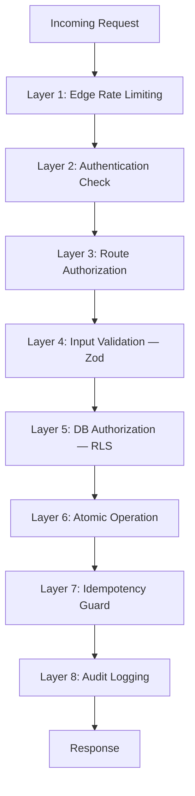
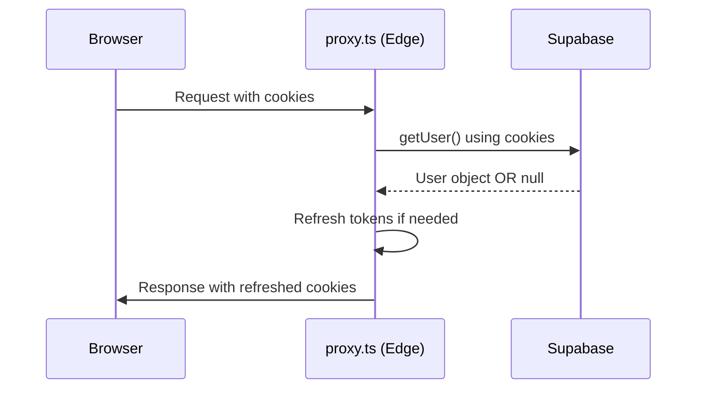

# Security Deep Dive

> **Audience:** Security engineers, hiring managers, and anyone evaluating VESTIOR for production use.
>
> **Scope:** Threat model, defense layers, implementation details, and incident response.

---

## Table of Contents

- [Threat Model](#threat-model)
- [Defense Layers](#defense-layers)
- [Authentication](#authentication)
- [Authorization](#authorization)
- [Row-Level Security (RLS)](#row-level-security-rls)
- [Server Action Security](#server-action-security)
- [Input Validation](#input-validation)
- [Atomic Operations](#atomic-operations)
- [Rate Limiting](#rate-limiting)
- [Idempotency](#idempotency)
- [Webhook Security](#webhook-security)
- [Secret Management](#secret-management)
- [Privacy: IP Hashing](#privacy-ip-hashing)
- [Audit Logging](#audit-logging)
- [CSP & Headers](#csp--headers)
- [Incident Response](#incident-response)
- [Security Checklist](#security-checklist)

---

## Threat Model

### Assets

| Asset | Value | Location |
|-------|-------|----------|
| User credentials | High | Supabase Auth (bcrypt-hashed) |
| Payment intents | Critical | Stripe (PCI-compliant) |
| Customer PII | High | Supabase `profiles`, `orders` |
| Order history | Medium | Supabase `orders`, `order_items` |
| Product data | Medium | Supabase `products` |
| Admin access | Critical | `profiles.role` |
| Business revenue | Critical | Stripe + orders |

### Threat Actors

| Actor | Motivation | Capability |
|-------|-----------|-----------|
| **Opportunistic attacker** | Free stuff, disruption | Automated scripts, known CVEs |
| **Malicious customer** | Refund fraud, discount abuse | Manipulating client state |
| **Competitor** | Data scraping | Distributed IPs, headless browsers |
| **Insider (ex-employee)** | Data theft | Former credentials |
| **State-level** | Rare | Advanced persistent threat |

### Attack Surface

- **Public storefront** — search, browse, cart
- **Authenticated customer area** — orders, profile, wishlist, reviews
- **Admin panel** — products, orders, payments, users, coupons
- **Webhooks** — Stripe, QStash
- **Cron endpoints** — low-stock, abandoned carts
- **API routes** — track, export, cart sync

### Risk Register

| Risk | Likelihood | Impact | Mitigation |
|------|-----------|--------|-----------|
| Price manipulation | High | High | Server-side price fetch |
| Oversell under concurrency | Medium | High | `FOR UPDATE` locks |
| Webhook replay | Medium | Medium | Idempotency keys |
| RLS bypass | Low | Critical | RLS on every table |
| Session hijacking | Low | Critical | HTTP-only cookies + PKCE |
| Open redirect | Low | Medium | Path validation |
| SQL injection | Very Low | Critical | Parameterized queries |
| XSS | Low | Medium | React escaping + CSP |
| Rate limit bypass | Medium | Low | IP-based + sliding window |
| Secret leak | Low | Critical | `server-only` + env validation |

---

## Defense Layers



**Principle:** No single layer is trusted. If Layer N fails, Layer N+1 must catch it.

**Example — the "rupee attack":**

A malicious user manipulates `localStorage.cart`:

```javascript
localStorage.setItem('cart', JSON.stringify([{
  id: 'real-product-id',
  name: 'Charcoal Overcoat',
  price: 1,          // ← Attacker-set price
  quantity: 1
}]))
```

**Layer 4 (Zod)** passes — the shape is valid.
**Layer 5 (RLS)** — the request is authenticated, but RLS doesn't check prices.
**Layer 6 (Atomic operation)** — `place_order_atomic` **does not accept a price from the client**. It reads `products.price` from the DB and computes totals server-side. The attacker's `price: 1` is discarded.

**Result:** The attack silently fails. The user sees the real price at checkout.

---

## Authentication

### Provider: Supabase Auth

We delegate authentication entirely to Supabase. This gives us:

- **bcrypt password hashing** (12 rounds)
- **JWT-based sessions** with refresh tokens
- **OAuth 2.0 + PKCE** for Google login
- **Email verification** flow with branded templates
- **Password reset** flow
- **Rate-limited login attempts** (Supabase-managed)

### Session storage

- **Storage:** HTTP-only cookies (`sb-access-token`, `sb-refresh-token`)
- **Not localStorage** — immune to XSS token theft
- **SameSite=Lax** — CSRF-safe for top-level navigation
- **Secure** in production — HTTPS-only

### Cookie flow



**Key insight:** Middleware refreshes cookies on every request. If the access token expired, the refresh token exchanges for a new one transparently. The user stays logged in.

### PKCE OAuth flow

For Google login, we use PKCE (Proof Key for Code Exchange):

1. Client generates `code_verifier` + `code_challenge` (SHA-256 of verifier).
2. Redirect to Google with `code_challenge`.
3. Google redirects to `/auth/callback?code=...`.
4. Server-side: exchange `code` for tokens, using the stored `code_verifier`.
5. Tokens set as HTTP-only cookies.

**Why PKCE over implicit flow?** Because implicit flow exposes tokens in URL fragments. PKCE adds a cryptographic proof that the same client that started the flow is the one finishing it.

### Email verification

- New signups receive a verification link.
- Until verified, the user can't log in.
- Verification link includes a one-time code with short TTL.

---

## Authorization

### Three layers

1. **Middleware** (`src/proxy.ts`) — Fast rejection, runs on Edge
2. **Server Action** — Re-verifies on every call
3. **RLS** — Last line of defense in Postgres

**Why three?** Because middleware can be bypassed (misconfigured matcher, edge outage). Server Actions are the real gate. RLS is the final guarantee.

### Middleware

```typescript
if (pathname.startsWith('/admin')) {
  if (!user) return redirectWithCookies('/auth/login')

  const { data: profile } = await supabase
    .from('profiles')
    .select('role')
    .eq('id', user.id)
    .single()

  if (profile?.role !== 'admin') return redirectWithCookies('/')
}
```

**Note:** This is a *first-pass* check. It's fast (Edge runtime) but not authoritative. The real check happens in each Server Action.

### Server Action authorization

Every admin Server Action begins with:

```typescript
const supabase = await createClient()
const { data: { user } } = await supabase.auth.getUser()
if (!user) throw new Error('Unauthorized')

const { data: profile } = await supabase
  .from('profiles')
  .select('role, email')
  .eq('id', user.id)
  .single()

if (profile?.role !== 'admin') throw new Error('Forbidden')
```

**Why against `profiles`, not JWT claims?** Because JWT claims can be stale (role changed after token issuance) and can't be revoked. Reading from the DB is authoritative and instantly reflects role changes.

---

## AI Chatbot Security

### Threat Model

| Threat | Mitigation |
|--------|-----------|
| Prompt injection | Client cannot send `system` role (Zod rejects) |
| Jailbreak attempts | System prompt explicitly says "decline" |
| Rate abuse | 20 messages/min/IP |
| Cost attack | Groq free tier caps at 1,000 req/day |
| PII leak via tools | Tools only query caller's own data (RLS) |
| Hallucinated prices | System prompt: "Never invent prices. Always call a tool." |
| Data manipulation | Tools are read-only — no INSERT/UPDATE/DELETE |

### Implementation

1. **Client sends only user/assistant messages.** Zod schema rejects any `system` role.
2. **Server-side system prompt.** Client has no control over instructions.
3. **Read-only tools.** `getMyOrders` uses RLS — can only see caller's own orders.
4. **No DB writes.** Tools never modify state.
5. **Fail-closed.** If `GROQ_API_KEY` missing, endpoint returns 503.

---

## Row-Level Security (RLS)

RLS is the **cornerstone** of Supabase security. Every table has policies that run *inside* Postgres, at the query engine level.

### The `is_admin()` helper

```sql
CREATE OR REPLACE FUNCTION public.is_admin()
RETURNS boolean
LANGUAGE sql
SECURITY DEFINER
STABLE
SET search_path = public, pg_temp
AS $$
  SELECT COALESCE(
    (SELECT role = 'admin' FROM public.profiles WHERE id = auth.uid()),
    false
  );
$$;
```

**Why `SECURITY DEFINER`?** Because this function reads `profiles` — which itself has RLS. Without `SECURITY DEFINER`, it would recurse infinitely. `SECURITY DEFINER` runs the function as the defining user (postgres), bypassing RLS for the query *inside* the function only.

**Why `STABLE`?** Postgres can cache the result within a single query. If RLS uses `is_admin()` in 5 subqueries, Postgres calls it once.

**Why `SET search_path`?** Prevents search-path hijacking. Without it, an attacker could create a `profiles` table in a schema that precedes `public`.

### Policy patterns

**Ownership pattern** (users see their own rows):
```sql
CREATE POLICY "Users read own orders"
  ON public.orders
  FOR SELECT
  TO authenticated
  USING (user_id = auth.uid() OR public.is_admin());
```

**Public-read pattern** (anyone can read active products):
```sql
CREATE POLICY "Anyone reads active products"
  ON public.products
  FOR SELECT
  TO public
  USING (is_active = true);
```

**Admin-only write pattern**:
```sql
CREATE POLICY "Admins insert products"
  ON public.products
  FOR INSERT
  TO authenticated
  WITH CHECK (public.is_admin());
```

**Conditional-insert pattern** (users can insert only their own rows, with forced defaults):
```sql
CREATE POLICY "Users insert own reviews"
  ON public.product_reviews
  FOR INSERT
  TO authenticated
  WITH CHECK (
    user_id = auth.uid()
    AND status = 'pending'  -- can't self-approve
  );
```

### What RLS gives us

- **Impossible to leak** another user's data via a bug in app code.
- **Works regardless of query origin** — Supabase client, psql, application code.
- **Enforced by Postgres**, not by our code. Can't be accidentally disabled by a typo.

### What RLS doesn't cover

- **Service-role queries** bypass RLS. This is why `supabaseAdmin` is `server-only`.
- **Raw SQL migrations** run as superuser. Not a runtime concern.
- **RPC functions** with `SECURITY DEFINER` — must audit carefully.

---

## Server Action Security

Server Actions are **public POST endpoints**. They look like function calls but they're HTTP requests anyone can trigger.

### Attack vector

```bash
curl -X POST https://vestior.vercel.app/checkout \
  -H "Content-Type: application/json" \
  -d '{"action":"placeOrder","args":[...]}' 
```

Even without knowing the exact format, an attacker can replay requests.

### Guarantees every Server Action provides

1. **Re-authenticate on every call** — cookies are sent, but we call `getUser()` fresh.
2. **Re-authorize against DB state** — role from `profiles`, not from request payload.
3. **Zod-validate every argument** — never trust types, always check at runtime.
4. **Fail closed** — thrown errors surface as toasts, no silent success.
5. **Rate limited** — via middleware tiers.

### Example: `updateOrderStatus`

```typescript
export async function updateOrderStatus(orderId: string, newStatus: string) {
  // 1. Shape validation
  if (!orderId || typeof orderId !== 'string') throw new Error('Invalid order ID')

  // 2. Value whitelist
  if (!ALLOWED_STATUSES.includes(newStatus)) throw new Error(`Invalid status`)

  // 3. Authenticate
  const supabase = await createClient()
  const { data: { user } } = await supabase.auth.getUser()
  if (!user) throw new Error('Unauthorized')

  // 4. Authorize
  const { data: profile } = await supabase
    .from('profiles').select('role').eq('id', user.id).single()
  if (profile?.role !== 'admin') throw new Error('Forbidden')

  // 5. Perform using service role
  await supabaseAdmin.from('orders').update({ status: newStatus }).eq('id', orderId)

  // 6. Audit
  await logAudit({ ... })
}
```

**6 distinct security checks.** Any one failing rejects the request.

---

## Input Validation

### Zod at every boundary

Every Server Action and API route validates inputs with Zod. Runtime validation, not TypeScript (which is erased at compile time).

**Example: cart items**
```typescript
const cartSchema = z.array(
  z.object({
    product_id: z.string().uuid(),
    quantity: z.number().int().min(1).max(50),
  })
).max(90)

const parsed = cartSchema.safeParse(items)
if (!parsed.success) throw new Error(parsed.error.issues[0].message)
```

**Why min(1) and max(50)?**
- `min(1)`: Can't order 0 or negative quantities.
- `max(50)`: Prevents bulk orders from a single cart.
- `.max(90)`: After merging duplicates, at most 30 distinct items.

### Defense against common attacks

| Attack | Zod rule |
|--------|----------|
| SQL injection | Zod ensures string type; parameterized queries handle escaping |
| XSS | Zod validates email format; React escapes output |
| Mass assignment | Only whitelisted fields accepted |
| Integer overflow | `.int().max(N)` prevents huge numbers |
| Array bombing | `.max(N)` on arrays |
| Null injection | `.min(1)` on strings |

### What Zod *doesn't* protect against

- **Business logic abuse.** Example: a user with 10 valid accounts redeeming a coupon 10 times. Zod sees valid UUIDs. This is why we have `per_user_limit` on coupons (checked in DB).
- **Race conditions.** Two simultaneous requests both pass validation. Atomic operations handle this.

---

## Atomic Operations

### The `FOR UPDATE` pattern

**Problem:** Two customers buy the last unit of a product at the same time.

**Without locking:**
```
T1: SELECT stock FROM products WHERE id='X' → 1
T2: SELECT stock FROM products WHERE id='X' → 1
T1: UPDATE products SET stock = 0 WHERE id='X'
T2: UPDATE products SET stock = 0 WHERE id='X'
Result: 2 orders, stock = 0 → oversold by 1
```

**With `FOR UPDATE`:**
```
T1: SELECT ... FOR UPDATE → acquires row lock, reads stock=1
T2: SELECT ... FOR UPDATE → waits for lock
T1: UPDATE stock = 0 → commits, releases lock
T2: (unblocks) reads stock=0 → RAISE EXCEPTION 'Insufficient stock'
Result: 1 order succeeds, 1 fails. Stock is accurate.
```

### Deadlock prevention

Multiple items in one order → multiple locks. If orders acquire locks in different orders, deadlock:

```
T1: LOCK(A), LOCK(B)
T2: LOCK(B), LOCK(A)
→ Deadlock
```

**Solution:** Canonical lock ordering. `place_order_atomic` locks rows by `id ASC`:

```sql
FOR v_item IN
  SELECT value FROM jsonb_array_elements(p_items)
  ORDER BY (value->>'product_id')::uuid ASC
LOOP
  PERFORM 1 FROM products WHERE id = ... FOR UPDATE;
  ...
END LOOP;
```

Now both T1 and T2 acquire locks in the same order. Deadlock impossible.

### Proof of correctness

We ran a concurrent test:
- 10 parallel requests, each ordering 1 unit
- Product stock = 5
- Result: **exactly 5 succeeded, 5 failed** with "Insufficient stock"

Same test for coupons with `usage_limit = 3`:
- 20 parallel redemptions
- Result: **exactly 3 succeeded, 17 failed** with "Coupon usage limit reached"

---

## Rate Limiting

### Tiered limiters

Different route groups get different limits, based on abuse potential:

| Tier | Route prefix | Limit | Rationale |
|------|-------------|-------|-----------|
| **auth** | `/auth` | 10/min | Login brute-force prevention |
| **admin** | `/admin` | 60/min | Legitimate admin work is slow |
| **orders** | `/checkout`, `/api/orders` | 20/min | Prevents scripted orders |
| **track** | `/api/track` | 100/min | Allows batching, blocks spamming |
| **general** | Everything else | 300/min | Generous for browsing |

### Sliding window algorithm

```typescript
new Ratelimit({
  redis,
  limiter: Ratelimit.slidingWindow(10, '1 m'),
  analytics: false,
  prefix: 'rl:auth',
})
```

**Why sliding window over fixed window?** Fixed windows allow burst at boundary (10 at 0:59, 10 at 1:00 = 20 in 2 seconds). Sliding window smooths this.

### Fail-open behavior

```typescript
try {
  const { success } = await limiter.limit(getClientKey(ip))
  if (!success) return 429
} catch (err) {
  console.error('[ratelimit] redis error:', err)
  // Allow the request
}
```

**Why fail-open?** If Redis is down, we don't want the entire site down. Better to allow some abuse than deny all legitimate users.

**Trade-off:** If Redis is persistently down, we lose rate limiting. This is *acceptable* — the site still works. Rate limiting is defense in depth, not a hard requirement.

---

## Idempotency

### The problem

Stripe retries webhooks if we don't respond in time. Same event arrives 3 times. Without idempotency:

- 3 emails sent to customer
- 3 duplicate rows in `payment_transactions`
- 3 audit log entries
- Possible confusion in admin panel

### The pattern

```typescript
async function withIdempotency<T>(
  { scope, key, ttlSeconds = 86400 },
  fn: () => Promise<T>
): Promise<T> {
  const lockKey = `idem:${scope}:${key}`
  const resultKey = `idem:result:${scope}:${key}`
  const lockValue = randomUUID()

  const acquired = await redis.set(lockKey, lockValue, { nx: true, ex: ttlSeconds })
  if (acquired !== 'OK') {
    const cached = await redis.get<T>(resultKey)
    if (cached !== null) return cached
    throw new Error('Operation in progress')
  }

  try {
    const result = await fn()
    await redis.set(resultKey, result, { ex: ttlSeconds })
    return result
  } finally {
    const current = await redis.get(lockKey)
    if (current === lockValue) await redis.del(lockKey)
  }
}
```

### Correctness details

1. **Two keys:** `lockKey` (mutex) and `resultKey` (cached value).
2. **`nx: true`:** Only set if key doesn't exist. Atomic in Redis.
3. **`lockValue`:** Random UUID so we know if *we* still own the lock.
4. **Ownership check in `finally`:** If our function ran longer than TTL, another process may have acquired the lock. We must not release *their* lock.

### Usage

```typescript
await withIdempotency(
  { scope: 'stripe-webhook', key: event.id, ttlSeconds: 86400 },
  async () => {
    await handleEvent(event.type, event.data)
  }
)
```

### Guarantee

Same Stripe event ID → **exactly one** side effect, even if the webhook fires 100 times.

---

## Webhook Security

### Stripe webhooks

**Signature verification:**
```typescript
const event = stripe.webhooks.constructEvent(
  body,                       // raw text, not parsed JSON
  signature,                  // from `stripe-signature` header
  process.env.STRIPE_WEBHOOK_SECRET!
)
```

**Why raw text?** Signature is computed over the exact bytes Stripe sent. If we `JSON.parse()` first and re-serialize, whitespace changes invalidate the signature.

**What this proves:**
- The request came from Stripe (shared secret).
- The payload wasn't modified in transit.

**What it doesn't prove:**
- That the event is fresh (replay protection needs idempotency).

### QStash webhooks

Similar: `Receiver.verify({ signature, body })` using `QSTASH_CURRENT_SIGNING_KEY` and `QSTASH_NEXT_SIGNING_KEY` (for rotation).

### Cron endpoints

Cron routes require a secret header:

```typescript
const auth = req.headers.get('authorization')
if (auth !== `Bearer ${env.CRON_SECRET}`) {
  return NextResponse.json({ error: 'Unauthorized' }, { status: 401 })
}
```

**Why not IP allow-list?** Because Vercel cron IPs change. Bearer token is simpler and portable.

---

## Secret Management

### Layers of isolation

1. **`.env.local`** — never committed. `.gitignore` enforced.
2. **`import 'server-only'`** — build-time error if imported by client component.
3. **Env validation** at startup — missing secrets fail the build.
4. **GitHub Secrets** — encrypted at rest, masked in logs, no fork access.
5. **Vercel env vars** — encrypted at rest, per-environment.

### Server-only modules

```typescript
// src/lib/supabase/admin.ts
import 'server-only'
// ↑ Next.js will throw if this is ever imported from a client component.
```

**Why this is powerful:** It's not just a convention. It's a **build-time guarantee**. If someone accidentally imports `supabaseAdmin` from a client component, the build fails with a clear error.

**Modules with `server-only`:**
- `lib/supabase/admin.ts`
- `lib/mongodb.ts`
- `lib/redis.ts`
- `lib/payments/providers/stripe.ts`
- `lib/email/mailer.ts`
- `lib/audit.ts`
- All `queries.ts` files
- All Server Actions

### Environment validation

```typescript
const serverSchema = z.object({
  SUPABASE_SERVICE_ROLE_KEY: z.string().min(1),
  STRIPE_SECRET_KEY: z.string().startsWith('sk_'),
  MONGODB_URI: z.string().refine(v => v.startsWith('mongodb')),
  // ... all required vars
})

const result = serverSchema.safeParse(process.env)
if (!result.success) {
  throw new Error(`Missing env vars:\n${result.error.issues.map(...)}`)
}
```

**Why fail fast?** Because discovering a missing env var at runtime (when a specific code path runs) is 100x worse than at build time.

---

## Privacy: IP Hashing

### The problem

Analytics tracking typically stores IP addresses. This is PII under GDPR.

### The solution

```typescript
const ipHash = createHash('sha256')
  .update(env.IP_HASH_SALT + ip)
  .digest('hex')
```

**Properties:**
- **Irreversible:** Can't reverse SHA-256 to get the IP.
- **Stable:** Same IP always produces same hash (within the salt's lifetime).
- **Salt-protected:** Without knowing `IP_HASH_SALT`, an attacker can't brute-force the hash.
- **Rotation:** Changing `IP_HASH_SALT` invalidates all historical hashes.

**What we use it for:**
- Detecting duplicate sessions
- Rate limiting per unique client
- Rough geographic clustering (with country/city from Vercel headers)

**What we can't use it for:**
- Identifying a specific user (that's what `user_id` is for)
- Complying with law enforcement requests (we simply don't have the IP)

---

## Audit Logging

### Every privileged mutation is logged

```typescript
await logAudit({
  actorId: user.id,
  actorEmail: profile.email,
  action: 'order.refund',
  targetType: 'order',
  targetId: orderId,
  before: { payment_status: 'completed' },
  after: { payment_status: 'refunded' },
  ip: requestIp,
  metadata: { refundId, reason },
})
```

### What's stored

| Field | Purpose |
|-------|---------|
| `actor_id` | Who did it (Supabase user UUID) |
| `actor_email` | Human-readable actor |
| `action` | What (`order.refund`, `coupon.create`, etc.) |
| `target_type`, `target_id` | What was affected |
| `before`, `after` | State change (JSON diff) |
| `ip_hash` | Where they were (hashed) |
| `timestamp` | When |

### What's NOT stored

- **Raw IPs** — hashed only
- **Request bodies** — only the diff
- **Passwords** — never touched

### Retention

Audit logs in MongoDB have **no TTL**. They're kept indefinitely for compliance.

### Admin panel

`/admin/audit` shows every action with filters by actor, action type, and target.

**Why it matters:** If an admin's account is compromised, the audit trail reveals the attack pattern. If a customer claims "I never got refunded," the log shows whether the refund was issued.

---

## CSP & Headers

### Current headers

```
X-Frame-Options: DENY
X-Content-Type-Options: nosniff
Referrer-Policy: strict-origin-when-cross-origin
Permissions-Policy: camera=(), microphone=(), geolocation=()
```

### Planned CSP

```
default-src 'self';
script-src 'self' 'unsafe-inline' https://www.googletagmanager.com https://js.stripe.com;
style-src 'self' 'unsafe-inline';
img-src 'self' data: blob: https://res.cloudinary.com https://*.supabase.co;
font-src 'self' data:;
connect-src 'self' https://*.supabase.co https://api.stripe.com https://*.upstash.io;
frame-src https://js.stripe.com;
object-src 'none';
base-uri 'self';
form-action 'self';
frame-ancestors 'none';
upgrade-insecure-requests;
```

### Why CSP matters

Even if an attacker injects `<script>` into a review body:
- No `unsafe-eval` → can't `eval()`.
- `script-src 'self'` → can't load external scripts.
- `connect-src` allowlist → can't exfiltrate data to arbitrary servers.

**Note:** `unsafe-inline` is required for Next.js inline scripts. Removing it requires nonces — planned for v3.1.

---

## Incident Response

### If a secret leaks

**Immediate (within 1 hour):**
1. Revoke the leaked secret in its provider (Stripe → rotate keys, Supabase → rotate service role, etc.).
2. Update the new secret in Vercel environment variables.
3. Redeploy.
4. Check audit logs for unauthorized actions in the last 24 hours.
5. Check Stripe dashboard for unusual payment intents.
6. Check MongoDB for unusual activity.

**Follow-up (within 48 hours):**
7. Post-mortem: How did it leak? (Git commit? Slack message? Screenshot?)
8. Update process to prevent recurrence.
9. Notify affected users if PII was exposed (GDPR requirement).

### If RLS is bypassed

**Immediate:**
1. Disable the affected Server Action (comment out).
2. Redeploy.
3. Audit MongoDB `events` for suspicious queries.
4. Rotate Supabase service role key.

**Investigation:**
5. Which policy failed? (Check `pg_policies`.)
6. Which query bypassed RLS? (Check Postgres logs.)
7. Fix policy, add test case.

### If Stripe is compromised

**Immediate:**
1. Rotate Stripe API keys.
2. Update Vercel env vars.
3. Verify webhook signing secret.
4. Check Stripe dashboard for unauthorized charges.
5. Issue refunds if fraud detected.

**Follow-up:**
6. Enable Stripe Radar for fraud detection.
7. Add request logging for all payment intents.

---

## Security Checklist

Use this when reviewing code changes.

### Authentication
- [ ] All new routes with user data call `auth.getUser()`.
- [ ] OAuth callbacks validate `next` param.
- [ ] Password reset flow uses Supabase's built-in (no custom).

### Authorization
- [ ] New admin routes call `is_admin()` in Server Action.
- [ ] New tables have RLS policies.
- [ ] Admin queries use `supabaseAdmin`, not client.

### Input validation
- [ ] Every Server Action validates arguments with Zod.
- [ ] Every API route validates body with Zod.
- [ ] Arrays have `.max(N)` limits.
- [ ] Numbers have min/max constraints.

### Atomic operations
- [ ] Multi-step writes use RPC with `FOR UPDATE`.
- [ ] Lock ordering is canonical (by ID ASC).
- [ ] Failures raise exceptions (no partial commits).

### Rate limiting
- [ ] New public routes have a limiter tier.
- [ ] Limiters fail-open (Redis outage tolerant).

### Idempotency
- [ ] Webhooks check idempotency key.
- [ ] Long-running operations check for existing result.

### Secrets
- [ ] New server-only modules import `server-only`.
- [ ] No secrets in client components.
- [ ] New env vars added to `env.ts` schema.
- [ ] New env vars added to `.env.example`.

### Audit
- [ ] New admin actions call `logAudit`.
- [ ] Audit includes before/after state.

### Privacy
- [ ] No raw IPs stored.
- [ ] No PII in logs.
- [ ] Sensitive data hashed before storage.

---

## Further Reading

- [OWASP Top 10](https://owasp.org/www-project-top-ten/)
- [Supabase RLS Guide](https://supabase.com/docs/guides/auth/row-level-security)
- [Stripe Security Guide](https://stripe.com/docs/security)
- [Postgres Row Locking](https://www.postgresql.org/docs/current/explicit-locking.html)
- [Architecture Deep Dive](./architecture.md)
- [Deployment Guide](./deployment.md)

---

<p align="center">
  <em>Last updated: 2026-10-12 · Maintained by <a href="https://github.com/zainshah3464">@zainshah3464</a></em>
</p>
```