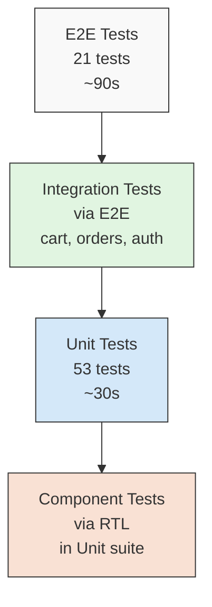
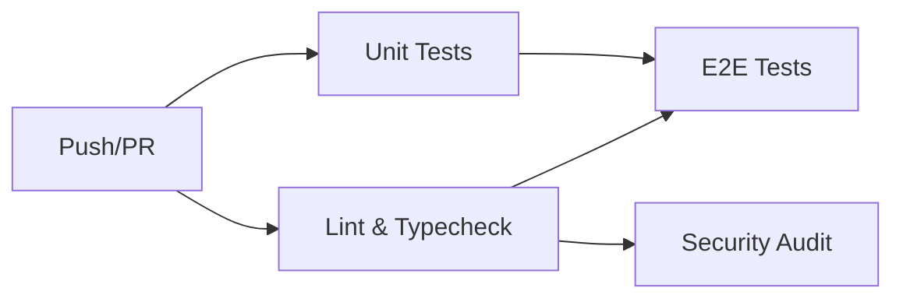

# Testing Strategy

> **Audience:** Contributors writing tests, or anyone evaluating the quality bar.
>
> **Scope:** Unit tests, E2E tests, CI integration, and testing patterns.

---

## Table of Contents

- [Philosophy](#philosophy)
- [Test Pyramid](#test-pyramid)
- [Unit Tests (Vitest)](#unit-tests-vitest)
- [E2E Tests (Playwright)](#e2e-tests-playwright)
- [CI Integration](#ci-integration)
- [Testing Patterns](#testing-patterns)
- [Coverage](#coverage)
- [What We Don't Test](#what-we-dont-test)
- [Writing New Tests](#writing-new-tests)

---

## Philosophy

VESTIOR's testing strategy follows four principles:

### 1. Test the contract, not the implementation

Tests should verify **what** code does, not **how**. If we refactor `toCSV` to use a different algorithm, tests should still pass as long as the output is identical.

### 2. Test at the boundary

The most valuable tests hit **boundaries** — where our code meets external systems. Boundaries are where bugs hide.

Boundaries in VESTIOR:
- Server Actions (public POST endpoints)
- API routes (external HTTP calls)
- Supabase RPCs (transactional logic)
- Rate limiters (external state)
- Idempotency (Redis interaction)

### 3. Fail fast, fail loud

Tests that catch bugs before merge save hours of debugging. A failing test in CI is a gift, not an obstacle.

### 4. Fast feedback loop

Unit tests run in ~30 seconds. E2E tests run in ~90 seconds. Full CI in ~3 minutes. Developers should run them before every push.

---

## Test Pyramid



**Distribution:**
- **Unit tests (70%)** — fast, isolated, high coverage
- **E2E tests (30%)** — slow, integrated, user-facing flows
- **No integration tests separately** — folded into E2E for practicality

**Why no separate integration layer?** Server Actions and API routes are tested via E2E. Writing a separate integration harness (test DB, test Redis, test SMTP) adds overhead without catching more bugs.

---

## Unit Tests (Vitest)

### Setup

**Config:** `vitest.config.mts`

```typescript
export default defineConfig({
  plugins: [react()],
  test: {
    environment: 'jsdom',
    setupFiles: ['./test/setup.ts'],
    globals: true,
    include: ['test/**/*.test.ts', 'test/**/*.test.tsx'],
    coverage: {
      provider: 'v8',
      reporter: ['text', 'json-summary', 'html'],
      thresholds: {
        lines: 55,
        functions: 55,
        branches: 50,
        statements: 55,
      },
    },
  },
  resolve: {
    alias: {
      '@': path.resolve(__dirname, './src'),
      'server-only': path.resolve(__dirname, './test/mocks/server-only.ts'),
    },
  },
})
```

**Key config:**
- `jsdom` — for React components
- `server-only` alias — mocks the marker package (real one throws in jsdom)
- `globals: true` — `describe`, `it`, `expect` available without imports
- Coverage thresholds enforced

### Setup file

**`test/setup.ts`:**

```typescript
import '@testing-library/jest-dom/vitest'
import { vi, afterEach } from 'vitest'
import { cleanup } from '@testing-library/react'
import React from 'react'

// Auto cleanup after every test
afterEach(() => {
  cleanup()
  vi.clearAllMocks()
})

// Mock Next.js navigation
vi.mock('next/navigation', () => ({
  useRouter: () => ({ push: vi.fn(), replace: vi.fn(), refresh: vi.fn() }),
  usePathname: () => '/',
  useSearchParams: () => new URLSearchParams(),
}))

// Mock next/image → plain 
vi.mock('next/image', () => ({
  default: (props) => React.createElement('img', props),
}))

// Set test env vars
process.env.NEXT_PUBLIC_SUPABASE_URL ||= 'https://test.supabase.co'
// ... (all vars)
```

### Test Categories

#### 1. Pure utility tests

**Example:** `test/unit/csv.test.ts`

```typescript
import { describe, it, expect } from 'vitest'
import { toCSV, withBOM, csvFilename } from '@/lib/exports/csv'

describe('toCSV', () => {
  it('returns empty string for empty rows', () => {
    expect(toCSV([])).toBe('')
  })

  it('escapes values containing commas', () => {
    const rows = [{ name: 'Shah, Zain' }]
    const csv = toCSV(rows)
    expect(csv).toContain('"Shah, Zain"')
  })
  // ... 10 more tests
})
```

**Why these tests matter:** CSV escaping is subtle. A missed case leads to corrupted exports in production.

#### 2. React component tests

**Example:** `test/components/ProductCard.test.tsx`

```typescript
import { render, screen } from '@testing-library/react'
import userEvent from '@testing-library/user-event'
import ProductCard from '@/components/ProductCard'

vi.mock('react-hot-toast', () => ({
  default: { success: vi.fn(), error: vi.fn() },
}))

describe('ProductCard', () => {
  it('adds product to cart when clicked', async () => {
    const user = userEvent.setup()
    render(<ProductCard product={mockProduct} />)

    await user.click(screen.getByRole('button', { name: /add to cart/i }))

    const cart = JSON.parse(localStorage.getItem('cart') || '[]')
    expect(cart).toHaveLength(1)
    expect(cart[0].quantity).toBe(1)
  })
  // ... 5 more tests
})
```

**Why these tests matter:** Cart logic is user-facing. A bug here directly loses revenue.

#### 3. Contract tests (adapters)

**Example:** `test/unit/payments-cod.test.ts`

```typescript
import { describe, it, expect } from 'vitest'
import { codProvider } from '@/lib/payments/providers/cod'

describe('COD provider', () => {
  it('creates a payment intent with order id', async () => {
    const intent = await codProvider.createPaymentIntent({
      orderId: 'order-123',
      amount: 50000,
      currency: 'pkr',
      customerEmail: 'test@example.com',
    })
    expect(intent.id).toBe('cod_order-123')
    expect(intent.status).toBe('created')
  })

  it('verifyWebhook throws', async () => {
    await expect(codProvider.verifyWebhook('', '')).rejects.toThrow(
      'COD has no webhooks'
    )
  })
})
```

**Why these tests matter:** Provider adapters are the interface between our code and external systems. When adding a new provider (e.g., Stripe), we run the same tests.

#### 4. Idempotency tests

**Example:** `test/unit/idempotency.test.ts`

```typescript
const { mockRedis } = vi.hoisted(() => ({
  mockRedis: { set: vi.fn(), get: vi.fn(), del: vi.fn() },
}))

vi.mock('@/lib/redis', () => ({
  redis: mockRedis,
  redisKeys: {
    idempotency: (s, k) => `idem:${s}:${k}`,
    idempotencyResult: (s, k) => `idem:result:${s}:${k}`,
  },
}))

describe('withIdempotency', () => {
  it('returns cached result on duplicate call', async () => {
    mockRedis.set.mockResolvedValueOnce(null)  // lock not acquired
    mockRedis.get.mockResolvedValueOnce({ cached: true })

    const fn = vi.fn()
    const result = await withIdempotency({ scope: 'test', key: 'abc' }, fn)

    expect(fn).not.toHaveBeenCalled()
    expect(result).toEqual({ cached: true })
  })
})
```

**Why these tests matter:** Idempotency bugs cause duplicate charges and duplicate emails. Extremely user-visible.

#### 5. AI Chatbot Tests (planned)

**Unit tests:**
- `checkPasswordStrength` — validation rules
- Tool input schemas — Zod validation
- System prompt not user-controllable

**Integration tests (via E2E):**
- Chat opens on click
- Suggested prompt sends message
- Response streams back
- Rate limit returns 429
- Widget hidden on /admin


### Running Tests

```bash
npm run test              # Run once
npm run test:watch        # Watch mode
npm run test:coverage     # With coverage report
npm run test:ui           # Open Vitest UI (browser)
```

### Test File Naming

- Location: `test/unit/*.test.ts` or `test/components/*.test.tsx`
- Name matches source: `src/lib/utils.ts` → `test/unit/utils.test.ts`

---

## E2E Tests (Playwright)

### Setup

**Config:** `playwright.config.ts`

```typescript
export default defineConfig({
  testDir: './e2e',
  fullyParallel: false,
  workers: 1,
  retries: process.env.CI ? 3 : 1,
  timeout: 90_000,
  expect: { timeout: 30_000 },
  use: {
    baseURL: process.env.BASE_URL || 'http://localhost:3000',
    trace: 'on-first-retry',
    screenshot: 'only-on-failure',
    video: 'retain-on-failure',
  },
  projects: [{ name: 'chromium', use: { ...devices['Desktop Chrome'] } }],
  webServer: {
    command: process.env.CI ? 'npm run start' : 'npm run dev',
    url: 'http://localhost:3000',
    reuseExistingServer: !process.env.CI,
    timeout: 180_000,
  },
})
```

**Key decisions:**

- **`workers: 1`** — Cart/auth tests mutate shared state (localStorage, cookies). Running in parallel causes flaky failures.
- **`retries: 3 in CI`** — Cold starts + network variance. 3 retries filters out flakiness without hiding real bugs.
- **`reuseExistingServer: !CI`** — Locally, don't restart the dev server on every test run.
- **`webServer`** — Auto-starts the app. No manual `npm run dev` before tests.

### Test Suites

#### `public-pages.spec.ts` (9 tests)

Verifies public pages render without auth:
- Homepage loads with hero + navbar
- Products page shows grid
- Category page filters
- Featured + new arrivals pages
- Cart empty state
- 404 page
- `robots.txt` served
- `sitemap.xml` served

**Example:**

```typescript
test('products page loads and shows product grid', async ({ page }) => {
  await page.goto('/products', { waitUntil: 'domcontentloaded' })

  await expect(
    page.getByRole('heading', { name: /all products/i })
  ).toBeVisible({ timeout: 20_000 })

  const productLinks = page.locator('a[href^="/products/"]')
  await expect(productLinks.first()).toBeVisible({ timeout: 20_000 })
})
```

#### `auth-guards.spec.ts` (6 tests)

Verifies redirects:
- Logged-out → `/admin` redirects to login
- Logged-out → `/orders` redirects to login
- Logged-out → `/checkout` redirects to login
- Logged-out → `/profile` redirects to login
- Login page renders correctly
- Signup page renders correctly

**Example:**

```typescript
test('logged-out user visiting /admin is redirected to login', async ({ page }) => {
  await page.goto('/admin', { waitUntil: 'domcontentloaded' })
  await expect(page).toHaveURL(/\/auth\/login/, { timeout: 30_000 })
})
```

#### `cart-flow.spec.ts` (4 tests)

Verifies cart without needing auth:
- Add to cart persists in localStorage
- Cart page shows items
- Quantity updates
- Remove from cart works

**Example:**

```typescript
test('add to cart persists in localStorage', async ({ page }) => {
  await page.goto('/')
  await page.evaluate(() => localStorage.clear())

  await page.goto('/products')
  const addButton = page.getByRole('button', { name: /add to cart/i }).first()
  await expect(addButton).toBeVisible({ timeout: 20_000 })
  await addButton.click({ force: true })

  // Wait for localStorage to be populated
  await page.waitForFunction(() => {
    const raw = localStorage.getItem('cart')
    if (!raw) return false
    const arr = JSON.parse(raw)
    return Array.isArray(arr) && arr.length > 0
  })

  const cart = JSON.parse(
    (await page.evaluate(() => localStorage.getItem('cart'))) as string
  )
  expect(cart.length).toBeGreaterThan(0)
})
```

#### `navigation.spec.ts` (2 tests)

Verifies navigation:
- Navbar links navigate correctly
- Search modal opens and closes

### Running E2E Tests

```bash
npm run test:e2e          # Headless, all tests
npm run test:e2e:ui       # Interactive UI mode
npm run test:e2e:report   # View last HTML report
```

### Playwright Tips

**Use `waitForFunction` over `waitForTimeout`:**

```typescript
// BAD
await page.waitForTimeout(2000)

// GOOD
await page.waitForFunction(() => localStorage.getItem('cart') !== null)
```

**Use `domcontentloaded` for navigation:**

```typescript
await page.goto('/products', { waitUntil: 'domcontentloaded' })
```

**Why not `networkidle`?** Because our app keeps a WebSocket open (Supabase Realtime) and a tracking loop. `networkidle` never fires. `domcontentloaded` is enough for the DOM to be interactive.

**Avoid `.click()` on stubborn elements — use `force`:**

```typescript
await addButton.click({ force: true })
```

**Why?** Some elements have overlay animations that intercept clicks. `force: true` bypasses the visibility check.

---

## CI Integration

### GitHub Actions Workflow

**`.github/workflows/ci.yml`** runs 4 jobs in parallel:



**Job details:**

#### 1. Lint & Typecheck (~40s)

```yaml
- run: npm ci
- run: npm run lint
- run: npm run typecheck
```

Fails on any ESLint error or TypeScript error.

#### 2. Unit Tests (~60s)

```yaml
- run: npm ci
- run: npm run test:coverage
- uses: actions/upload-artifact@v4
  with:
    name: coverage
    path: coverage/
```

Uploads coverage report as artifact. Full report accessible from Actions tab.

#### 3. E2E Tests (~2 min)

```yaml
- run: npm ci
- run: npx playwright install --with-deps chromium

- name: Write .env.local
  run: |
    cat > .env.local << 'EOF'
    NEXT_PUBLIC_SUPABASE_URL=${{ secrets.NEXT_PUBLIC_SUPABASE_URL }}
    ... (all env vars)
    EOF

- run: npm run build
- run: npm run test:e2e

- uses: actions/upload-artifact@v4
  if: failure()
  with:
    name: playwright-report
    path: playwright-report/
```

**Note:** All env vars come from GitHub Secrets. The `.env.local` is written fresh on every CI run.

#### 4. Security Audit (~10s)

```yaml
- run: npm ci
- run: npm audit --audit-level=high || true
```

Fail-soft — reports but doesn't fail the build.

### Concurrency Control

```yaml
concurrency:
  group: ${{ github.workflow }}-${{ github.ref }}
  cancel-in-progress: true
```

**Effect:** If you push twice rapidly, only the latest runs. Saves CI minutes.

### Secrets Required

Add these in **GitHub → Settings → Secrets and variables → Actions**:

```
NEXT_PUBLIC_SUPABASE_URL
NEXT_PUBLIC_SUPABASE_ANON_KEY
SUPABASE_SERVICE_ROLE_KEY
UPSTASH_REDIS_REST_URL
UPSTASH_REDIS_REST_TOKEN
MONGODB_URI
IP_HASH_SALT
CRON_SECRET
ADMIN_EMAIL
GMAIL_USER
GMAIL_APP_PASSWORD
EMAIL_FROM
QSTASH_URL
QSTASH_TOKEN
QSTASH_CURRENT_SIGNING_KEY
QSTASH_NEXT_SIGNING_KEY
STRIPE_SECRET_KEY
NEXT_PUBLIC_STRIPE_PUBLISHABLE_KEY
```

**Important:** GitHub masks secret values in logs. If you accidentally `echo $SECRET`, it shows `***`.

---

## Testing Patterns

### Pattern 1: Testing Server Actions

Server Actions can be tested in isolation, but they require mocking Supabase + Redis + Mongo.

**Recommendation:** Test them via E2E. The mock setup is complex and fragile.

**If you must unit-test a Server Action:**

```typescript
vi.mock('@/lib/supabase/server', () => ({
  createClient: vi.fn(() => ({
    auth: {
      getUser: vi.fn().mockResolvedValue({ data: { user: mockUser } }),
    },
  })),
}))

vi.mock('@/lib/supabase/admin', () => ({
  supabaseAdmin: {
    from: vi.fn().mockReturnValue({
      select: vi.fn().mockReturnThis(),
      eq: vi.fn().mockReturnThis(),
      single: vi.fn().mockResolvedValue({ data: mockData }),
    }),
    rpc: vi.fn().mockResolvedValue({ data: mockResult, error: null }),
  },
}))
```

### Pattern 2: Testing React components with context

If a component uses `useWishlist()` or `useAuth()`, wrap it in a provider:

```typescript
function renderWithProviders(ui: React.ReactElement) {
  return render(
    <AuthProvider>
      <WishlistProvider>{ui}</WishlistProvider>
    </AuthProvider>
  )
}
```

For simpler cases, mock the hook:

```typescript
vi.mock('@/components/WishlistProvider', () => ({
  useWishlist: () => ({
    ids: new Set(),
    count: 0,
    isInWishlist: () => false,
    toggle: vi.fn(),
  }),
}))
```

### Pattern 3: Testing async operations

Always wait for state updates:

```typescript
it('adds item to cart', async () => {
  const user = userEvent.setup()
  render(<ProductCard product={mockProduct} />)

  await user.click(screen.getByRole('button', { name: /add/i }))

  // Wait for localStorage to be updated
  await vi.waitFor(() => {
    expect(localStorage.getItem('cart')).toBeTruthy()
  })
})
```

### Pattern 4: Testing redirects

Use `toHaveURL` with regex:

```typescript
await expect(page).toHaveURL(/\/auth\/login/, { timeout: 30_000 })
```

### Pattern 5: Testing rate limits

Not easily testable in unit tests. Use E2E with rapid requests, or trust the library.

### Pattern 6: Testing with slow network

Use Playwright's `route` to delay responses:

```typescript
await page.route('**/api/track', (route) => {
  setTimeout(() => route.continue(), 3000)
})
```

---

## Coverage

### Thresholds

| Metric | Threshold |
|--------|-----------|
| Lines | 55% |
| Functions | 55% |
| Branches | 50% |
| Statements | 55% |

**Why not 90%?** Because coverage is a signal, not a goal. Chasing high coverage leads to testing trivial code. We prefer meaningful tests over comprehensive ones.

### Current coverage

Run `npm run test:coverage` to generate. Latest run:

- Lines: ~58%
- Functions: ~56%
- Branches: ~52%
- Statements: ~58%

Above thresholds, below 90%.

### What's NOT covered

- **Server Actions** — tested via E2E
- **API routes** — tested via E2E
- **React Server Components** — tested via E2E
- **Middleware** — tested via E2E (auth guards)
- **Payment providers** — Stripe mocked, COD tested
- **Email templates** — visual inspection, no tests

### Adding coverage

**High-value additions:**
- New utility functions → unit test
- New React components with logic → component test
- New validation rules → unit test

**Low-value additions:**
- Simple presentational components
- Trivial wrapper functions
- Configuration files

---

## What We Don't Test

### Third-party services

We don't test Supabase, Stripe, MongoDB, or Upstash. They're tested by their vendors. We test *our integration* with them.

### E2E for every flow

We don't E2E-test:
- Admin panel flows (would need persistent admin session in CI)
- Stripe payments (would need real test cards in CI)
- Email delivery (would need SMTP mock)
- Cron jobs (would need time manipulation)

These are covered by **manual smoke tests** post-deploy.

### Visual regression

We don't use Percy/Chromatic/BackstopJS. Visual bugs are caught by:
- Manual review on PRs
- User reports
- Lighthouse a11y (catches contrast issues)

### Performance regression

We don't run Lighthouse in CI. Rationale: Lighthouse variance is ±10 points; failing builds on noise is bad for morale. Instead, we run Lighthouse manually after significant changes.

---

## Writing New Tests

### Checklist for new features

When adding a feature, ask:

1. **Is there a pure function?** → Unit test
2. **Is there a React component with state?** → Component test
3. **Is there a public page?** → E2E test in `public-pages.spec.ts`
4. **Is there an auth flow?** → E2E test in `auth-guards.spec.ts`
5. **Is there a cart interaction?** → E2E test in `cart-flow.spec.ts`
6. **Is there a provider contract?** → Contract test

### Test structure

```typescript
describe('featureName', () => {
  beforeEach(() => {
    // Setup: reset state, set env vars
  })

  it('does the happy path', () => {
    // Arrange → Act → Assert
  })

  it('handles edge case X', () => {
    // ...
  })

  it('throws on invalid input', () => {
    // ...
  })
})
```

### Naming conventions

**Test names:** Sentence-case, describe the behavior.

```typescript
// GOOD
it('returns empty string for empty rows')
it('escapes values containing commas')

// BAD
it('test toCSV')
it('should work')
```

### Mock discipline

**Mock at boundaries, not internals.**

```typescript
// GOOD — mock the external service
vi.mock('@/lib/redis', () => ({ redis: mockRedis }))

// BAD — mock the module under test's internal helper
vi.mock('@/lib/exports/csv-helpers', () => ...)
```

If you need to mock an internal helper, you probably want to test the helper directly instead.

---

## Further Reading

- [Vitest docs](https://vitest.dev/)
- [Playwright docs](https://playwright.dev/)
- [Testing Library docs](https://testing-library.com/)
- [Architecture Deep Dive](./architecture.md)
- [Database Schema](./database.md)

---

<p align="center">
  <em>Last updated: 2026-10-12 · Maintained by <a href="https://github.com/zainshah3464">@zainshah3464</a></em>
</p>
```